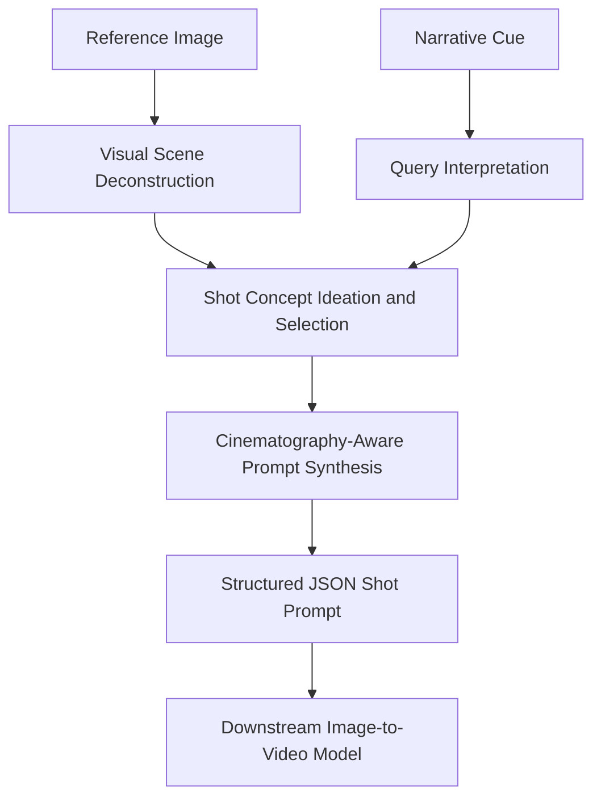

# Multimodal Image-to-Video Prompt Engineering Assistant

**An image-conditioned, cinematography-aware prompt assistant for image-to-video generation.**

**Creator:** Aza Atzhanova  
**Project context:** Higgsfield AI hackathon; developed as an individual assistant within the broader team project.  
**Original Custom GPT:** [higgsfield i2v](https://chatgpt.com/g/g-68f36befecf48191802e4d15b860c057-higgsfield-i2v) *(legacy link; availability may change).*  
**Status:** Documentation of the original Custom GPT configuration. This repository does not contain a separately deployed model or an independent inference implementation.

## Overview

This assistant translates a **reference image** and a **short narrative cue** into a single, detailed **JSON-formatted shot prompt** intended to guide image-to-video generation systems. Its instructions combine visual scene analysis, narrative interpretation, cinematography vocabulary, and an explicit output structure.

The assistant was **individually created and configured by Aza Atzhanova**. It was used in the context of a larger hackathon team project; this repository documents her own assistant, rather than claiming sole authorship of the team's other work.

## Workflow

*The final box indicates the intended downstream use; video generation is not performed by this Custom GPT itself.*

## Design

| Component | Purpose |
|---|---|
| **Visual deconstruction** | Identify subject, environment, lighting, composition, palette, and aesthetic from the reference image. |
| **Narrative conditioning** | Use a short user cue to specify movement, action, or mood change. |
| **Shot ideation** | Instruct the underlying model to consider several possible shot concepts before selecting one. This is a prompting strategy, not a separate search algorithm. |
| **Cinematography-aware synthesis** | Specify camera movement, framing, lens, lighting, color grade, action, and sound design. |
| **Structured output** | Request a single JSON object with fixed fields to support consistent downstream usage. The configuration does not itself guarantee machine-validated JSON. |
| **Creative guardrails** | Restrict certain subject matter and maintain professional, non-explicit tone. |

## Output schema

The required JSON object has these top-level keys:

- `shot_concept`
- `scene_elements` (`subject_description`, `environment_details`, `key_props`)
- `action_and_narrative`
- `cinematography` (`camera_motion`, `framing_and_lens`, `lighting_and_palette`)
- `audio_design` (`ambient_sound`, `foley`, `music_cue`)
- `technical_style_directives`
- `negative_prompt`

The **exact prompt configuration** is preserved in [`docs/original-instructions.md`](docs/original-instructions.md). These are instructions for a configured assistant, **not a training pipeline or custom model weights**.

## Technical scope

**Methods and concepts:** multimodal prompting; image-conditioned narrative generation; visual scene decomposition; cinematographic shot design; structured JSON generation; creative prompt constraints.

**Not claimed:** model fine-tuning, custom image recognition architecture, dedicated inference backend, programmatic JSON validation, benchmark results, or autonomous video rendering.

## Demonstrations

A documented input/output example and optional generated video can be added later. No synthetic demonstration or unverified performance claims are included in this initial version.

## Attribution

**Assistant design and configuration:** Aza Atzhanova (individual work).  
**Hackathon context:** broader team project; no claim of sole authorship of other team deliverables.

## Notes

The original Custom GPT link is provided as historical context and is **not** intended to be the sole permanent demonstration. This repository preserves a readable description and its authored prompt specification independently of the hosted interface.
